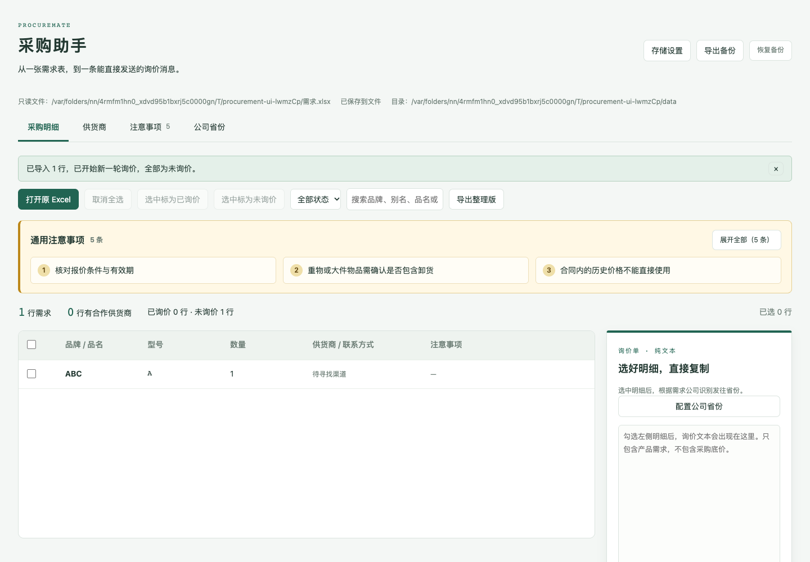

> 0.3.30：移除采购明细表中的“注意事项”列；保留序号旁的红色感叹号和悬浮提示，通用提醒徽章及展开面板不变。

> 0.3.29：在采购摘要区域增加“⚠ 通用提醒”数量徽章，点击后展开提醒内容。

> 0.3.28：通用提醒移到顶部标题区右侧空白区域，收起时仅显示一行摘要，点击后展开提醒列表。

> 0.3.27：通用提醒移到导航栏下、状态提示上方，收起时单行显示，点击可展开更多内容。

> 0.3.26：通用提醒移到右侧询价卡片下方，不再占用操作栏区域；红色感叹号移至序号列并增加悬浮提示。

> 0.3.25：采购明细显示导入序号；通用提醒移到摘要下方，不再挤压操作栏；支持行右键菜单标记询价和取消全选；指定品牌及品牌提醒以红色感叹号显示，悬停查看内容。

# 采购助手 · ProcureMate

面向 DeepSeek Harness 的采购助手插件，将 Excel 采购需求整理为可复制的询价文本，并集中管理供货商、询价进度和采购提醒。



## 功能

|   | 使用方式 |
| --- | --- |
| Excel 需求导入 | 支持 `.xls`、`.xlsx`，识别表头，可选择工作表和列对应关系 |
| 询价文本 | 勾选明细生成纯文本，可编辑后复制至微信或电商客服 |
| 供货商管理 | 保存品牌、别名、联系人、微信、电话和店铺网址；匹配已有供货商 |
| 公司省份 | 配置需求公司对应的发往省份，优先于公司名称中的地名推断 |
| 询价进度 | 勾选后批量标记已询价或未询价，通过行底色、计数和筛选区分 |
| 采购提醒 | 通用提醒显示在表格上方；品牌、品名相关提醒显示在对应行 |
| 资料维护 | 供货商、提醒和公司省份支持 Excel 模板、JSON 导入导出；支持资料备份和目录切换 |
| 整理版导出 | 导出明细、供货商联系方式及有表头的其他原始列 |

## 安装与兼容范围

对外名称为 **ProcureMate**，安装包名称为 `dsh-procuremate`。

1. 获取维护者提供的 `.tgz` 安装包。若仓库 Releases 尚未提供附件，可按下方开发步骤自行构建并运行 `npm pack`。
2. 从 DeepSeek Harness Desktop 打开 **Open DSH Terminal**，使用当前激活的 profile。
3. 执行以下命令，将示例路径替换为安装包的实际绝对路径：

   ```sh
   dsh plugin add '/absolute/path/dsh-procuremate-0.3.24.tgz'
   ```

4. 重启 Desktop，从侧边栏打开“采购助手”。升级使用新版安装包重复上述操作。

卸载命令：

```sh
dsh plugin remove dsh-procuremate
```

从旧包迁移时，请先在同一 DSH Terminal 中运行 `dsh plugin remove dsh-procurement-workbench`，再安装新包，避免两个包重复注册同一入口。原资料目录及目录设置路径保留。

卸载不会主动删除资料文件。插件基于 Desktop `0.2.0-rc.2` 的公开接口开发；浏览器预览已验证，当前发布包尚未进行 Desktop 实机加载验收。Windows 文件选择分支有代码测试，尚未实机验收。详细范围见 [兼容说明](COMPATIBILITY.md)。

## 快速使用

1. 在“供货商”录入品牌及联系方式，或下载模板批量导入。
2. 点击“打开原 Excel”，确认工作表、表头及列对应关系，至少对应品牌、型号和数量。
3. 查看表格上方的通用注意事项；超过三条时可展开全部。对应商品的提醒在行内展示。
4. 勾选需要询价的明细，核对右侧文本和发往省份。无法识别时可进入“公司省份”配置；省份提示不阻止复制。
5. 点击“复制询价文本”，自行粘贴发送。复制不会自动标记已询价。
6. 完成询价后，勾选相应行并点击“选中标为已询价”。蓝色底色代表已询价，可筛选或改回未询价；注意事项列保留原有底色。

**每次确认导入都开始新一轮询价，导入的明细全部重置为未询价。** 取消导入不改变当前状态。

公司省份请按实际收货地配置；名称推断仅供核对。同一公司配置一个省份，多收货地场景需要人工确认。

## 数据与限制

- 原 Excel 只读，插件不会修改、回填或覆盖原文件。
- 参考资料和询价标记保存在 `~/buyer/data/procurement-workbench.json`，可在“存储设置”切换目录。只有顶部显示“已保存到文件”才表示保存成功。
- 目录设置保存在 `~/.config/dsh-procurement-workbench/storage.json`。默认预览与 Desktop 会使用同一套配置；开发时建议使用隔离目录。
- 采购明细不作为独立明细表持久化，重新打开工作台后需重新导入。询价标记的匹配记录包含来源路径及行内容，备份资料也可能包含这些采购信息。
- 不产生自动备份，可手动“导出备份／恢复备份”。恢复备份会替换资料；分类资料导入也会替换对应类别，操作前有确认。
- 保存失败时保留页面修改，可重试；多窗口冲突不会静默覆盖。重新载入会放弃未保存修改。
- 支持 `.xls` 和 `.xlsx`，不支持 `.xlsm`、图片或 HTML 伪装的 Excel。文件上限 20 MB，明细上限 10000 行，列对应选项最多显示前 100 列。
- 公式读取文件中缓存的结果，不执行计算。合并的需求公司单元格会读取主单元格；其他字段的合并空白需人工确认。
- 整理版保留业务字段和有表头的其他原始列，不保留原样式、公式、宏及其他工作表。单价和物料编码不作为导入界面的专用字段展示。
- 品牌按名称及显式别名匹配；“不限”“市场件”等不视为具体品牌。仅填写品牌而未提供供货商名称或联系渠道的记录，不算已有合作供货商。
- 官网自动搜索、店铺归属核实和网页联系方式提取尚未实现。不自动发送消息、登录电商账号或下单。
- 询价文本默认包含含税含运费及 13% 增值税专用发票要求，发送前可按实际情况编辑。内部采购提醒不会自动加入询价文本。

## 开发、贡献与许可证

本地开发需要 Node.js 和 npm。当前未声明最低 Node.js 版本，建议先运行测试确认环境兼容性。

```sh
npm ci
npm run build
npm test
npm run preview
```

预览地址为 `http://127.0.0.1:4173`。预览默认使用真实资料目录；隔离预览与界面测试方法见 [贡献指南](CONTRIBUTING.md)。

生成安装包：

```sh
npm run build
npm pack
```

欢迎提交问题、文档改进和代码贡献。请勿在 Issue、截图或测试中提交真实采购表、联系人资料或服务密钥。

项目采用 [MIT License](LICENSE)。第三方依赖许可见各依赖包及 [SheetJS 许可声明](lib/SHEETJS-LICENSE.txt)。

- [更新记录](CHANGELOG.md)
- [验证记录](VALIDATION.md)
- [兼容说明](COMPATIBILITY.md)
